# Silver Mirror

<sub>Formerly `SkinKey`: code identifiers (`@skinkey/*`, `app.skinkey`, the Worker URL) keep the old name.</sub>

> The tag says oily skin. Your scan and the ingredients get a vote.

**One line:** share a skincare product from the Flipkart, Amazon.in or Nykaa Android app and Silver Mirror checks the listing's ingredient list against your own YouCam Skin Analysis reading, then shows the rule behind every reason.

Cosmetic guidance, not medical advice. Not affiliated with Flipkart, Amazon or Nykaa.

<p>
  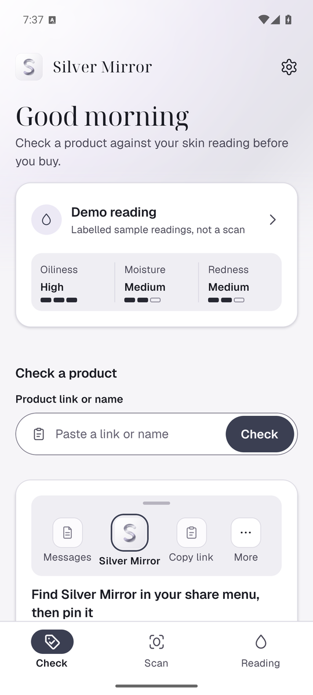
  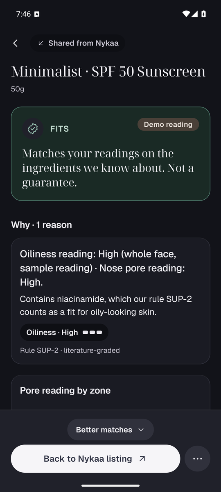
  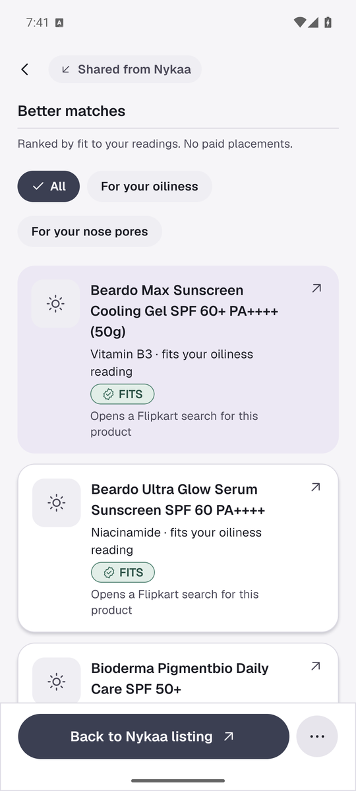
  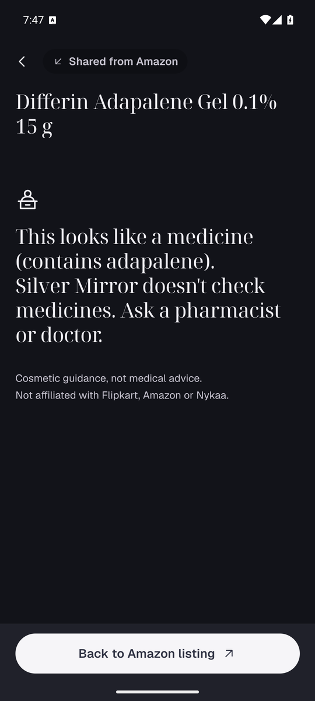
</p>

## The problem

A shopper finds a moisturiser through a reel, opens the listing, and reads "for oily skin". That tag is written by the seller. Whether it suits *their* skin is a guess, and the guess is expensive.

Desk research only, labelled as such: nobody was interviewed for these numbers, and the figures come from `design/research/05_desk_research_baseline.md` (graded A to D there):

- Opened skincare usually can't be returned on Nykaa and Purplle (finding 3, grade C).
- About 40% of self-reported skin types matched instrument measurement (Youn et al. 2002, via a secondary summary; finding 1, grade A).
- 43% of shoppers worry that AI recommendations are paid placements (Harris Poll, *The Algorithmic Aisle*; finding 6, grade B).
- Store skin tools exist (Flipkart's ModiFace analyser, Nykaa Skin Scan), but each one recommends from its own shelf (finding 9).

What we claim about the scan: it is a consistent, dated reading from YouCam. It is not a validated measurement, and Silver Mirror does not close the 40% gap on its own.

## How it works

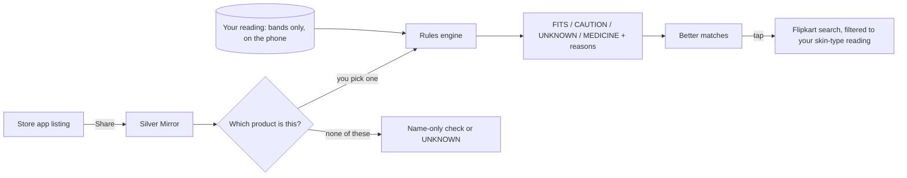

1. **Your reading (once).** Consent, then one selfie. YouCam HD Skin Analysis returns oiliness, moisture, redness, pore and per-zone skin-type readings. The Worker turns each `raw_score` into a band (Low / Medium / High). Higher `raw_score` means *less* visible concern, so the bands invert it (found in the live spike). The photo is deleted from YouCam straight after; only bands, zone labels and the scan date stay on the phone. A labelled **Demo reading** lets anyone try the app without a scan.
2. **Share.** Flipkart or Nykaa: Share, then Silver Mirror. Amazon: Share, then More, then Silver Mirror (Amazon puts third-party apps behind More).
3. **Confirm.** Claude proposes catalogue rows; you tap the one you are looking at. No verdict appears before that. "None of these" gives a weaker, name-only check.
4. **Verdict with reasons.** A pure rules engine compares the product's INCI list and label claims with your bands. Every reason is a set template filled with a rule id, a band and an ingredient, for example *"Contains niacinamide, which our rule SUP-2 counts as a fit for oily-looking skin."* The four states differ by label, icon and outline, not colour alone; CAUTION is amber, never red.
5. **Better matches.** Up to 3 FITS products from the verified catalogue in the same category, ranked by fit ("No paid placements"), plus a link that opens a Flipkart search filtered to your skin-type reading (verified on a real phone: the Flipkart app opens with the filter applied).
6. **UNKNOWN is designed, not an error.** "We can't read this listing's ingredients. This doesn't mean it's bad." Snap the label; Claude reads it into editable ingredient chips; you confirm; the rules decide.
7. **Try-on (tinted products).** Two shades on the same photo. "Preview, not a shade guarantee." The skin-tone colour stays inside the Worker to pick two candidate shades and is never shown; the photo is deleted from YouCam afterwards. **Current limit:** the try-on button only appears for a tinted product with a shade colour on file, and no catalogue row has one yet (we won't invent shade colours). The YouCam side is verified in the live spike (`spikes/g5_*.jpg`, sample face) and in mock tests; the in-app screen shown below is the labelled sample preview.
8. **Medicine gate.** Adapalene, tretinoin and other medicine actives stop the flow with a MEDICINE notice instead of a fit verdict.
9. **How this was made.** Every scan, try-on and label read keeps a ledger: YouCam task ids, units, delete state, and whether the run was mock or live.

## YouCam API chain (real numbers)

Base `https://yce-api-01.makeupar.com`. Keys live only in the Worker. Numbers below come from our live spike on Perfect Corp's official sample face (`spikes/FINDINGS.md`, 1 Nov 2026) and the live price list (`research/youcam_live_facts.md`).

| Step | Endpoint | Units | Measured |
|---|---|---:|---|
| Upload slot, then presigned `PUT` | `POST /s2s/v2.0/file` | 0 | |
| HD Skin Analysis: `hd_skin_type`, `hd_oiliness`, `hd_moisture`, `hd_redness`, `hd_pore` | `POST /s2s/v2.1/task/skin-analysis`, poll `GET …/{task_id}` | 16 (HD, 5–8 concerns) | success on the first poll at **5.4 s** |
| Skin tone, for try-on shade choice | `POST /s2s/v2.0/task/skin-tone-analysis`, poll `GET …/{task_id}` | 20 | price list only; mock-tested, not in the spike |
| Makeup VTO, two shades | `POST /s2s/v2.0/task/makeup-vto`, poll `GET …/{task_id}` | 1 each | about **5.3 s** each; foundation at `colorIntensity` 60 reads clearly side by side |
| Delete | `POST /s2s/v2.0/task/delete` | 0 | `200`; confirmed after **about 2 s** |
| Balance and price check for the ledger | `GET /s2s/v1.0/client/credit`, `GET /s2s/v2.0/credit/feature-cost` | 0 | |

- One reading costs 16 units; a two-shade try-on costs 22 (tone 20 + 2 renders). The spike spent 18 units in total.
- YouCam also returns an overall score and `skin_age`. We drop both: bands only, never a number.
- `hd_skin_type` comes back per zone (`whole`, `t_zone`, `u_zone`), which is what lets reasons say "whole face" or "nose pore reading".

## Privacy

- Consent first, with an 18+ tick. The consent screen lists exactly what stays on the phone: skin-type reading, Low / Medium / High bands, zone labels, scan date.
- "Silver Mirror stores no photo; YouCam processes it and we delete it from YouCam right after."
- **Delete flow, verified live (G0):** the delete call returned `200`; a GET straight after still returned results (eventual consistency); about 2 s later and at every later check (t+0/20/40 s) the GET returned `400 "This task ID doesn't exist"` and the mask URL returned `404`. So the Worker runs a delete state machine (`uploaded → … → delete_requested → deleted | delete_failed`) and only shows "Deleted from YouCam" after a confirming GET: first check 2 s after the delete, up to 3 checks, up to 2 delete attempts. Unit-tested in `apps/worker/test/deleteState.test.ts`.
- Settings has **Delete my reading** and **Withdraw consent**. Readings expire after 30 days.
- Keys (`YOUCAM_API_KEY`, `ANTHROPIC_API_KEY`) exist only as Worker secrets; `npm run secrets:grep` checks the web bundle and both APKs for them.

## Honesty: Claude reads, our rules decide

- Claude (`claude-opus-5-5`, structured JSON output) has exactly two runtime jobs: mapping a messy share title to catalogue ids (effort low), and reading a label photo into ingredient tokens (effort medium). It never writes verdict text and never decides a verdict.
- `packages/rules` is a pure function with no network or SDK imports: 11 published rules (OCC-1, OCC-2, FRG-1, ALC-1, SUP-1, SUP-2, LC-1a, LC-1b, LC-2, LC-3, MED-1), each with an evidence grade and sources. The web `/rules` page renders them, and every verdict shows the ruleset version (`440f555a8845`).
- Catalogue: 180 rows from 30 brand files; 125 are usable for verdicts because a second, independent read matched the brand page's ingredient list word for word. Retailer rows never count. 0 rows ticked by a person so far, and the app labels the tier it used.
- A copy linter (`npm run lint:claims`) fails the build on the banned words in brief §4.4 across app, web, shared copy, this README and the submission docs.

## Audit: brand claims checked against their own ingredient lists

Method `brand-claims-1`, pre-registered in [`audit/METHOD.md`](audit/METHOD.md). It uses only brand-page rows already in `data/catalog/brands/`; no store page is read, scraped or screenshotted (the earlier Flipkart-filter frame would have needed automated store access, which Flipkart's terms don't allow). Git tags, each made before the next step ran:

| Tag | Commit | What it froze |
|---|---|---|
| `audit-method-frozen` | `561344d` | the method file |
| `rules-frozen` | `2122b55` | ruleset `440f555a8845` + SHA-256 of every rules file (`audit/rules-frozen.json`) |
| `audit-run` | `19ef9a2` | `audit/results.csv`, `audit/summary.json`, `audit/review.md` |

Headline, copied from `audit/summary.json` (schema 2, generated 2 Nov 2026 04:45 UTC, headline run, not a pilot):

- **140** products make a skin-type or free-from claim on their own brand page; **136** have a complete ingredient list there.
- Label Check: **0 of 136** make a claim their own ingredient list doesn't match (strict LC-1a / LC-2 / LC-3), and 0 more under LC-1b. Only 16 free-from claims were testable (fragrance-free 4, alcohol-free 1, oil-free 11).
- Claim vs reading profile: **70 of 136** are flagged CAUTION by our rules for a reading profile their own claim points to. 62 of them list a fragrance ingredient (FRG-1) and are flagged for the high-redness profiles. By claim: "for oily skin" 33 of 60, "for sensitive skin" 30 of 52, "for all skin types" 30 of 52, "non-comedogenic" 11 of 24, "for combination skin" 10 of 24, "for dry skin" 0 of 28.
- Six reading profiles, CAUTION counts: Oily 13, Combination 12, Oily & Redness 72, Combination & Redness 67, Normal 0, Dry 12.
- 86 flagged rows on 70 products are on `audit/review.md` with claim quote, ingredient, rule id and brand page URL; **0 reviewed by a person so far**.
- The ruleset hash matched the frozen record. Three implementation files differ from it (`catalog.ts`, `catalogMerge.ts`, `index.ts`) and the run names them, as the method requires.

Flagged by our published rules, not a measured effect on skin. Our sample, not the market.

## Architecture

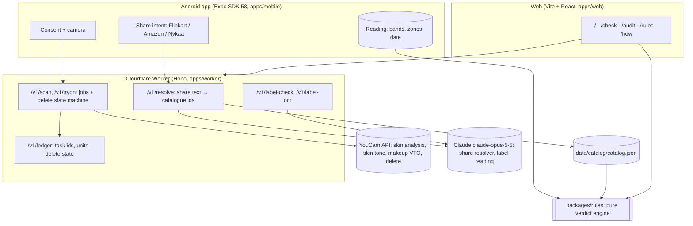

- `packages/contracts`: zod schemas for every route and the set copy strings. `packages/design`: tokens (`design/system/tokens`) for React Native and CSS, light and dark.
- Mock mode (`YOUCAM_MODE=mock`, `CLAUDE_MODE=mock`) serves the real spike responses with signed URLs redacted. Tests, the smoke script and the emulator QA use it, so no YouCam units are spent.

## What's possible / not possible

| Possible today | Not possible (and why) |
|---|---|
| Share from the native Flipkart, Amazon.in and Nykaa Android apps into Silver Mirror | Running within a store app. Our links open a Flipkart search in the Flipkart app |
| Resolve a Flipkart short link from one redirect header | Reading Flipkart product pages. We never load or scrape them |
| Check a listing's label claim ("for oily skin", fragrance-free, oil-free) against its INCI list and your readings | Checking a product we have no ingredient list for. That is UNKNOWN until you snap the label |
| Dated, banded YouCam readings (Low / Medium / High, zone labels) | Numeric skin scores or an age estimate. YouCam returns them; we discard them |
| Two-shade try-on on a tinted product with a known shade colour (API verified live; catalogue shade colours still to be added) | Try-on for tinted products without a shade colour on file. The app hides it rather than guess, which today means every catalogue row |
| Deleting the photo from YouCam right after the result, confirmed by retry | Instant deletion. YouCam deletes with about a 2 s lag, so we confirm before showing the tick |
| A pre-registered audit of brand-page claims against the same page's ingredient list | Statements about the whole market. It is our sample of 30 brands |
| Medicine actives detected and gated | Medical advice of any kind |
| Android APK, light and dark themes following the phone | iOS (roadmap) |

## Run it

Requires Node 24. On a small machine, run the heavy steps on a build VM with `scripts/remote.sh`, which rsyncs the working tree (no `.git`, no secrets), runs the command there and pulls back any `--pull` path:

```
scripts/remote.sh -- 'npm run typecheck && npm test && npm run lint'
scripts/remote.sh --pull audit -- 'npm run audit'
scripts/remote.sh --pull design/emulator-shots -- 'ops/vm/emu.sh start dark && ops/vm/emu.sh qa dark'
```

Locally, or on the VM:

```
npm install
npm run typecheck          # every workspace
npm test                   # vitest across packages/* and apps/*
npm run lint               # workspace lint + lint:claims (copy linter: app, web, contracts, README, docs/*.md)
npm run smoke:mock         # wrangler dev in mock mode on :8797 + 20 HTTP checks
npm run dev:worker         # Worker on :8787 (mock YouCam by default)
npm run dev:web            # web on :5173
npm run secrets:grep       # greps the web bundle + APKs for keys
npm run audit              # brand-page claims vs own INCI → audit/results.csv, summary.json, review.md
npm run catalog:merge      # rebuild data/catalog/catalog.json + AUDIT.md
```

Android: `dist-apk/silver-mirror-release.apk` talks to the deployed Worker; `dist-apk/silver-mirror-release-localworker.apk` talks to `http://localhost:8787` (run `adb reverse tcp:8787 tcp:8787` with the Worker running). To build: `scripts/build-android.sh`, or `cd apps/mobile/android && ./gradlew assembleRelease`. Live mode needs `apps/worker/.dev.vars` (generated from `.env` by `npm run gen:devvars`; never committed). Every live YouCam call spends units.

## Screenshots

Emulator (Android 15, release APK, mock Worker, Demo reading) and web, light and dark. Try-on frames are labelled sample previews: no face appears in shipped UI.

| | | | |
|---|---|---|---|
|  | 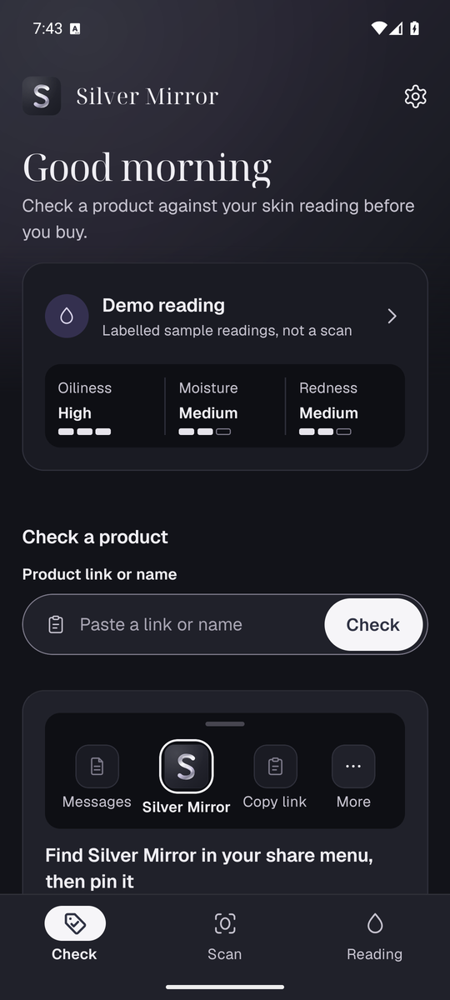 | 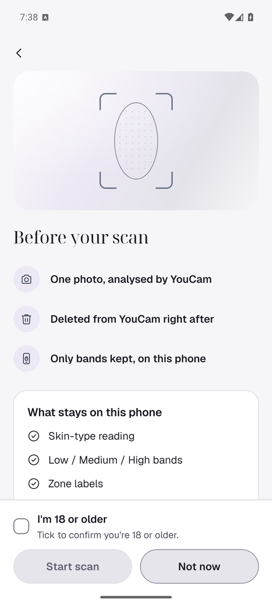 | 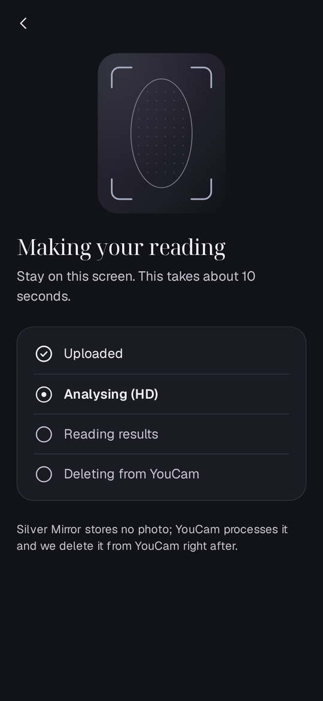 |
| Home (light) | Home (dark) | Consent: what stays on the phone | Scan steps end with "Deleting from YouCam" |
| 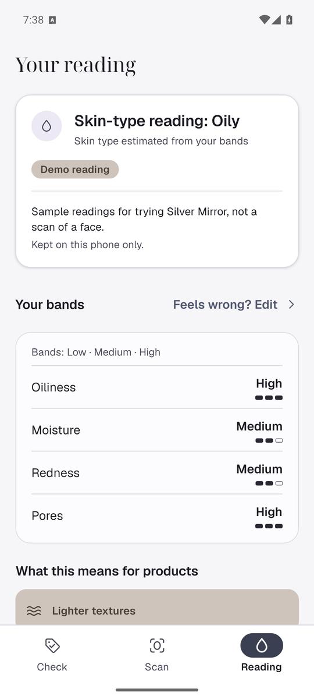 | 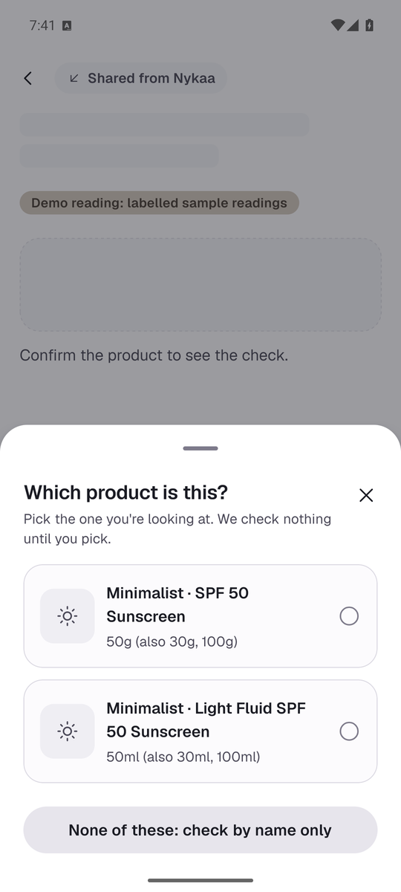 |  | 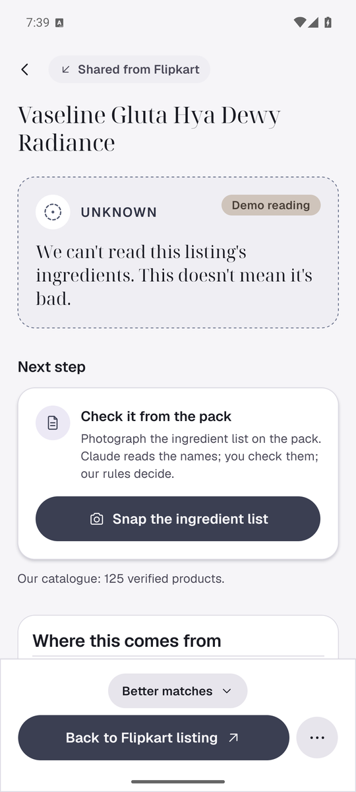 |
| Your reading: bands, never a score | Confirm the product first | FITS with rule SUP-2 | UNKNOWN with a next step |
|  |  | 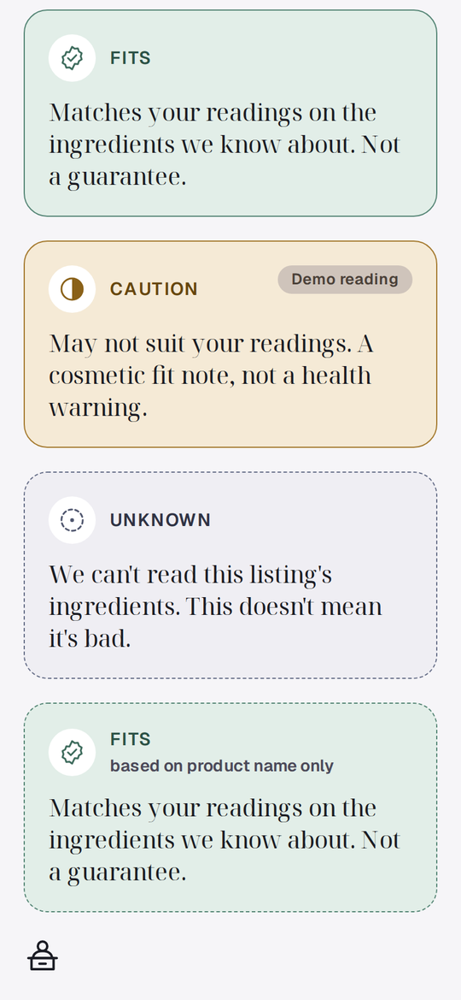 | 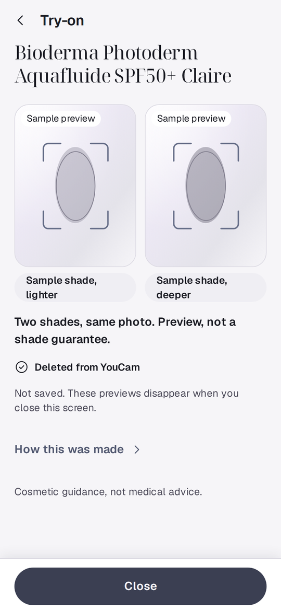 |
| Better matches, no paid placements | Medicine gate | FITS / CAUTION / UNKNOWN / name-only | Try-on: two shades, same photo |

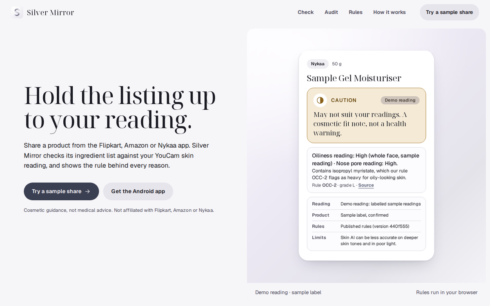
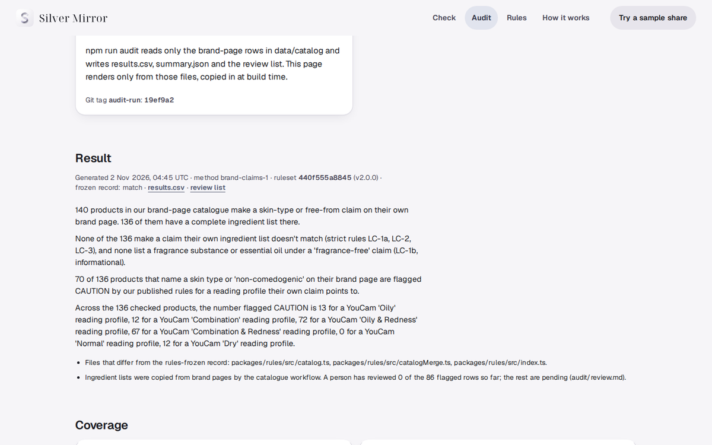
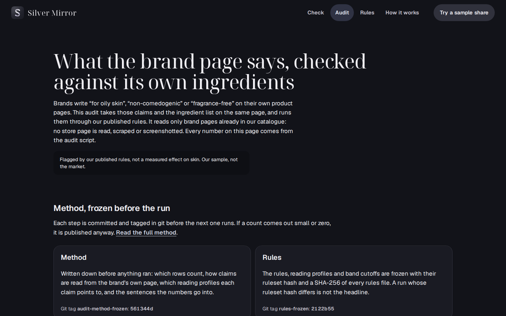

## Repo map

- `apps/mobile`: Expo SDK 58 app (share intent, scan, check, try-on, reading, settings, How this was made)
- `apps/worker`: Cloudflare Worker, YouCam and Claude adapters, mock YouCam, smoke script
- `apps/web`: landing, `/check`, `/audit`, `/rules`, `/how`
- `packages/contracts`, `packages/rules`, `packages/design`
- `data/catalog`: brand files, merged catalogue, audit of the merge
- `audit/`: method, frozen rules record, results
- `spikes/FINDINGS.md`: live API results that shaped the build
- `research/skinkey_v2_spec.md`: the locked spec. `docs/DEVPOST.md`, `docs/DEMO_SCRIPT.md`: submission text and video plan

## Roadmap

- Fresh hallway feedback from real shoppers, then band cutoffs calibrated on consenting people (current cutoffs are provisional).
- A person reviews the 86 flagged audit rows; re-run as `audit-run-2` if anything changes.
- Re-scan refresh after 30 days; Hindi; iOS.
- Pharmacist QR for the medicine gate.
- For retailers: the same rules as a catalogue check on seller feeds (`POST /v1/label-check`), run on the retailer's own YouCam account.

## Credits

YouCam Skin Analysis, Skin Tone Analysis and Makeup VTO by Perfect Corp. Claude by Anthropic. Ingredient names follow EU CosIng. Built for the YouCam API Skin AI & eCommerce VTO hackathon by Aman.
